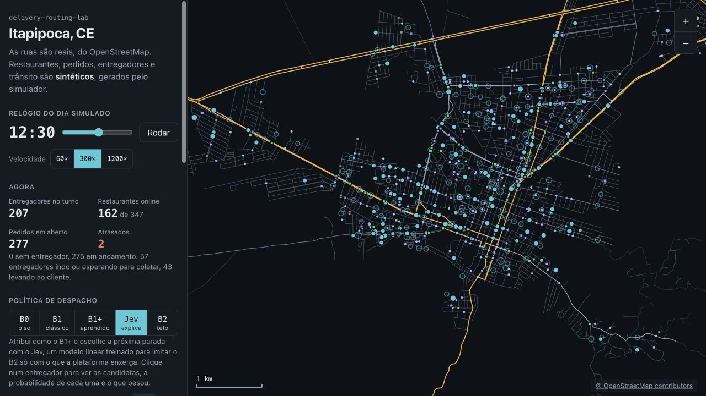
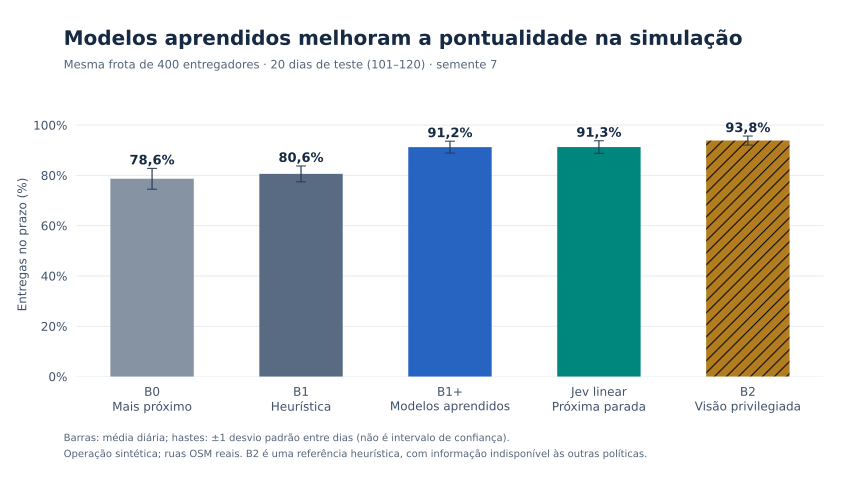
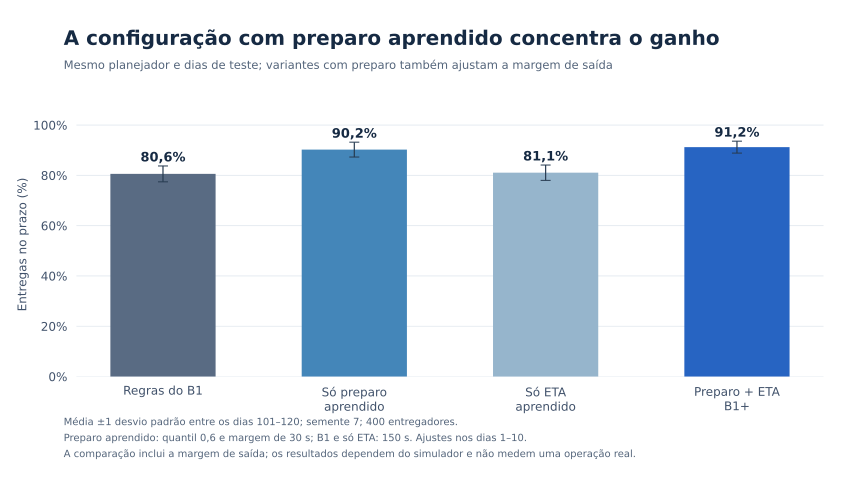
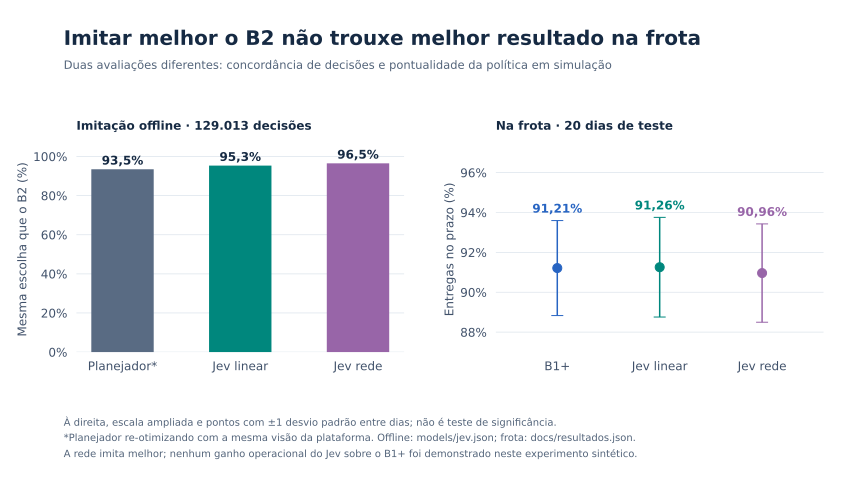
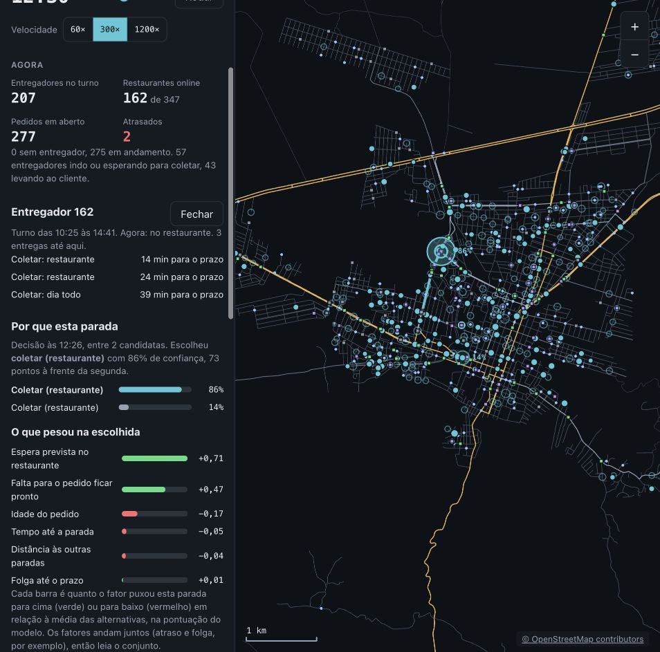
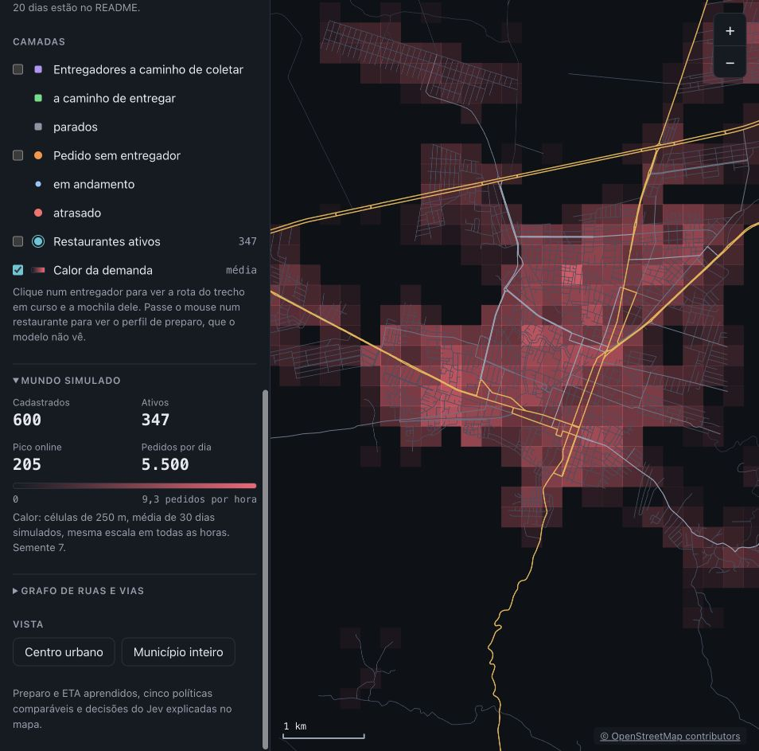

# delivery-routing-lab

**[Demo e resultados](https://juan-severiano.github.io/delivery-routing-lab/)** · **[Abrir o mapa interativo](https://juan-severiano.github.io/delivery-routing-lab/mapa/)**

**Quando mandar um entregador buscar um pedido que ainda está sendo preparado?** Este laboratório compara regras clássicas e modelos aprendidos para atribuir pedidos e escolher a próxima parada sobre as ruas de Itapipoca (CE).

Em 20 dias simulados, prever preparo e tempo de viagem elevou as entregas no prazo de **80,6% para 91,2%** frente ao mesmo planejador com regras fixas. O **Jev**, modelo linear que explica a próxima parada, ficou em **91,3%**: resultado próximo ao B1+, sem ganho operacional demonstrado.

> **Dados operacionais sintéticos.** Só as ruas vêm do OpenStreetMap. Restaurantes, pedidos, entregadores, turnos, preparo e trânsito são gerados pelo simulador. Os resultados não são de uma operação comercial.



[Apresentação visual](docs/delivery-routing-lab.html) · [Como funciona: etapas, fluxogramas e treino](https://juan-severiano.github.io/delivery-routing-lab/como-funciona/) · [Metodologia completa](docs/metodologia.md) · [Resultados por dia](docs/resultados.json) · [Executar o mapa](#executar-o-mapa)

## O experimento

As cinco políticas recebem os mesmos dias de pedidos e a mesma frota. O que muda é a informação disponível e como atribuem pedidos ou escolhem paradas.

| Política | Como decide | Informação usada |
|---|---|---|
| **B0: regra simples** | Atribui ao entregador livre mais próximo; visita a parada mais próxima | Distância em linha reta; sem estimativa de preparo ou trânsito |
| **B1: planejador clássico** | Inserção de coleta e entrega no plano, seguida de 2-opt; pode adiar a saída | Tempo livre das ruas e regra fixa de 700 s de preparo |
| **B1+: previsões aprendidas** | Mesmo planejador, trocando regras pelos modelos de preparo e ETA | Restaurante, hora, previsão de chuva, posições e histórico sintético |
| **Jev: próxima parada explicada** | Atribui como B1+; um modelo linear escolhe a próxima parada e devolve probabilidades e contribuições dos fatores | Mesmas estimativas acessíveis ao B1+; aprende a imitar B2 |
| **B2: referência privilegiada** | Mesma heurística de inserção e 2-opt | Preparo verdadeiro e trânsito corrente do simulador; não conhece o ruído da viagem |

**B2 não é o ótimo global nem um limite matemático.** Ele serve para medir a diferença observada que informação melhor pode fazer dentro desta heurística e deste ambiente.

## Resultados principais

Preset `plataforma`, semente 7, 400 entregadores e capacidade de 3 pedidos. Médias dos **mesmos 20 dias de teste (101 a 120)**; `±` é o desvio padrão entre dias, não um intervalo de confiança.

Cada política recebeu **106.401 pedidos**: 105.511 foram entregues e 890 ficaram sem entrega (0,84%). A pontualidade considera apenas os entregues; os totais e as métricas de cada dia estão no [snapshot](docs/resultados.json).

| Política | Entregas no prazo | Atraso P90 | Tempo médio do pedido | Km por pedido |
|---|---|---|---|---|
| B0 | 78,6% ± 4,1 | 12,5 min | 34,1 min | 4,88 |
| B1 | 80,6% ± 3,2 | 6,7 min | 32,8 min | 3,89 |
| **B1+** | **91,2% ± 2,4** | **0,4 min** | **31,2 min** | **4,25** |
| **Jev linear** | **91,3% ± 2,5** | **0,4 min** | **31,3 min** | **4,27** |
| B2, privilegiado | 93,8% ± 1,8 | 0,0 min | 28,0 min | 4,17 |



O B1+ ganha **10,6 pontos percentuais** sobre o B1 e percorre mais quilômetros por pedido. Aproxima-se do resultado da referência privilegiada sem acessar preparo ou trânsito verdadeiros. É uma troca entre prazo, distância e espera, medida na simulação.

### Aprender preparo valeu mais que aprender trânsito

O planejador com preparo aprendido chegou a **90,2%** no prazo, frente aos **80,6%** do B1. A variante só com ETA chegou a **81,1%**; com os dois modelos, a **91,2%**. Outro regime de trânsito pode mudar essa comparação.

As variantes com preparo aprendido usam o quantil 0,6 e margem de saída de 30 s; B1 e a variante só com ETA usam 150 s. Esses ajustes foram escolhidos nos dias 1 a 10. A comparação inclui essa mudança de configuração; não isola o efeito do modelo mantendo a margem fixa.



### Imitar melhor não garantiu entregar melhor

O Jev linear escolhe a mesma parada que B2 em **95,3% de 129.013 decisões de teste** e tem erro de calibração esperado de **0,007**. Isso mede imitação, não a taxa de entregas no prazo. Com o Jev dirigindo a frota, o resultado ficou próximo ao B1+.

Uma rede pequena imitou melhor (**96,5%**), mas ficou em **91,0%** de entregas no prazo. A versão linear foi mantida no mapa por oferecer contribuições exatas dos fatores e resultado operacional semelhante, com menor complexidade.



## Veja a decisão no mapa

O replay permite trocar entre as cinco políticas, avançar o relógio, acompanhar pedidos, selecionar entregadores e inspecionar rotas. Na política **Jev**, clique em um entregador em deslocamento para ver as paradas candidatas, suas probabilidades e os fatores que pesaram na escolha.



As barras explicam a pontuação do **modelo** em relação às alternativas; não demonstram causas de atraso no mundo real. O mapa mostra um dia de replay. As tabelas e gráficos resumem 20 dias.

Veja as [condições e os passos para reproduzir as capturas](docs/capturas.md), incluindo o entregador 162 e a decisão com duas alternativas exibida acima.



## Como a comparação foi controlada

- **Dias separados:** o planejador foi afinado nos dias 1 a 10. Preparo/ETA treinam nos 21 a 60 e validam nos 61 a 70; Jev treina nos 21 a 50 e valida nos 61 a 65. Todos são avaliados nos dias 101 a 120.
- **Mais de uma régua:** regras simples, planejador clássico, previsões aprendidas e referência com informação privilegiada. Ablações isolam preparo e ETA; o Jev é avaliado offline e conduzindo a frota.
- **Métricas de operação e de modelo:** prazo, atraso, tempo, distância, erro de previsão e calibração. Pedidos recusados por ausência de entregador de turno são contados separadamente e excluídos das métricas de entrega.
- **Verificações automatizadas:** conectividade e caminhos, eventos e turnos, capacidade e precedência da mochila, determinismo, métricas calculadas à mão, gradientes, inferência, persistência e proteção contra acesso ao preparo verdadeiro pelos modelos sem privilégio.

A malha usada na medição tem **7.288 cruzamentos e 19.320 arestas dirigidas**. O mundo contém 600 restaurantes cadastrados e gera aproximadamente 5,3 mil pedidos por dia com restaurante disponível. A rede, as perdas, o Adam e o loop de treino foram implementados no projeto; PyTorch fornece tensores e autograd. O forward de inferência é NumPy. Veja [arquitetura, hipóteses e resultados detalhados](docs/metodologia.md).

## Publicação e demo

A [apresentação](https://juan-severiano.github.io/delivery-routing-lab/), o [guia de funcionamento](https://juan-severiano.github.io/delivery-routing-lab/como-funciona/) e o [mapa interativo](https://juan-severiano.github.io/delivery-routing-lab/mapa/) são publicados no GitHub Pages. O guia mostra as decisões em quatro fluxogramas interativos, com blocos arrastáveis, zoom e tela cheia, além dos fluxos de treino/avaliação e dos [quatro modelos gerados](models/README.md). O mapa usa um **snapshot congelado do dia 101**, com as cinco políticas: abrir a demo não executa treino nem simulação no navegador.

O pacote em [`demo/`](demo/README.md) contém a cidade, o mundo e os cinco replays em JSON compactado, além do [recorte OSM original](demo/itapipoca-roads.osm.json.gz). O [manifesto](demo/manifest.json) registra os arquivos e seus hashes. A publicação restaura esses dados diretamente em `_site/mapa/data/`, sem alterar `web/public/data/`, buscar um mapa novo ou instalar PyTorch.

Para montar e servir a mesma demo localmente, use Node compatível com o Vite e Python 3, a partir da raiz do repositório:

```bash
npm --prefix web ci
python3 scripts/build_pages.py
python3 -m http.server --directory _site
```

Abra `http://localhost:8000/` para a apresentação e `http://localhost:8000/mapa/` para o replay. O [script de publicação](scripts/build_pages.py) compila a interface e monta `_site/`; depois da instalação das dependências, esse processo usa apenas arquivos locais, sem Overpass, API paga ou credencial de IA.

O workflow de GitHub Pages publica a pasta montada automaticamente a cada push na `main`. O pacote de dados é distribuído sob [ODbL 1.0](demo/LICENSE-data.txt), com atribuição ao OpenStreetMap; o código permanece sob MIT. A fonte OSM usada na demo também fica disponível no site em [`dados/itapipoca-roads.osm.json.gz`](https://juan-severiano.github.io/delivery-routing-lab/dados/itapipoca-roads.osm.json.gz).

## Executar o mapa

Os comandos abaixo recriam os dados e os replays pelo simulador. Para apenas abrir o snapshot publicado, use a [demo](#publicação-e-demo).

Requer [uv](https://docs.astral.sh/uv/), Python **3.12+** e Node **20.19+ na série 20, ou 22.12+**. Execute da raiz do repositório. Os pesos de preparo, ETA e Jev estão versionados em `models/`; não é necessário treinar para abrir o replay.

```bash
uv sync --extra train
uv run delivery-lab city fetch
uv run delivery-lab city build
uv run delivery-lab world build --preset plataforma --seed 7
uv run delivery-lab paths build

# Gera os cinco replays que a interface carrega.
for policy in b0 b1 'b1+' jev b2; do
  uv run delivery-lab sim run --policy "$policy" \
    --preset plataforma --seed 7 --couriers 400 \
    --days 1 --first-day 101 --render-day 101 \
    --render 'web/public/data/replay-{policy}.json'
done

npm --prefix web ci
npm --prefix web run dev
```

Abra o endereço local exibido pelo Vite (normalmente `http://localhost:5173`). O placeholder `{policy}` gera, entre outros, `replay-b1plus.json`, nome esperado pela interface. A preparação baixa as ruas uma vez (cerca de 7 MB) e calcula caminhos entre todos os cruzamentos (cerca de 320 MB em disco). Se o recorte OSM já existir, pule `city fetch`; ele não o substitui sem `--force`.

O extra `train` instala PyTorch: o forward usa NumPy, mas os módulos dos modelos ainda importam PyTorch. Os comandos acima usam os pesos publicados sem reexecutar treino. Não há API paga nem credencial de IA.

O mapa OSM pode mudar entre downloads. Para os pesos publicados, mantenha `plataforma` e semente 7; outra configuração exige novos modelos. Os arquivos de trabalho em `data/raw/`, `data/out/` e `web/public/data/` continuam fora do versionamento; o recorte OSM original e os sete JSONs da demo estão congelados como gzip em `demo/`. A [metodologia](docs/metodologia.md#fonte-do-mapa-e-limites-de-reprodução) explica como usar essa fonte para reconstruir o mesmo grafo.

## Reproduzir resultados e validar

Com o grafo e os caminhos preparados:

```bash
# Métricas das cinco políticas nos mesmos 20 dias de teste.
for policy in b0 b1 'b1+' jev b2; do
  uv run delivery-lab sim run --policy "$policy" \
    --preset plataforma --seed 7 --couriers 400 --days 20 --first-day 101
done

# Gráficos, a partir dos resultados salvos.
uv run --with matplotlib python scripts/plot_results.py

# Testes e compilação da interface.
uv sync --extra dev --extra train
uv run pytest
npm --prefix web run build
```

Os [resultados por dia](docs/resultados.json) acompanham os gráficos. A [reprodução detalhada](docs/metodologia.md#reprodução) inclui reexecutar a coleta, ablações, treino e bancada de heurística contra enumeração.

## Limites e escopo

O laboratório demonstra avaliação e decisões técnicas **dentro de uma simulação**. Os modelos aprendem o gerador que criamos: não foram validados em uma operação real, outra cidade ou várias sementes de mundo. Preparo tem rótulo limpo, a chuva é conhecida e o trânsito segue regras simples. A divisão entre dias evita usar o teste na escolha, mas não elimina essas simplificações.

O Jev foi treinado e testado com mochila de 3 pedidos; as probabilidades indicam concordância com B2. A medição com mais pedidos avaliou somente latência. As médias próximas de Jev e B1+ não estabelecem superioridade nem equivalência estatística. Oferta e aceite de despacho continuam como experimento futuro; o escopo atual termina na comparação das políticas e na explicação da próxima parada.

## Licenças

Código sob [MIT](LICENSE). O [pacote demo](demo/README.md), incluindo o recorte OSM e os dados derivados, é distribuído sob [ODbL 1.0](demo/LICENSE-data.txt). Ruas: © [OpenStreetMap contributors](https://www.openstreetmap.org/copyright). Os dados operacionais são inteiramente sintéticos.
