# Como o laboratório funciona

[Guia publicado](https://juan-severiano.github.io/delivery-routing-lab/como-funciona/) · [Página do projeto](https://juan-severiano.github.io/delivery-routing-lab/) · [Código](../README.md) · [Metodologia detalhada](metodologia.md) · [Resultados por dia](resultados.json)

Na [página interativa](https://juan-severiano.github.io/delivery-routing-lab/como-funciona/), os quatro fluxogramas permitem mover blocos, navegar pelo quadro, aplicar zoom e abrir em tela cheia. As imagens abaixo são as versões estáticas de referência.

O laboratório compara formas de **atribuir pedidos a entregadores**, **escolher a próxima parada** e **decidir quando sair para uma coleta**. As ruas são de Itapipoca, no OpenStreetMap. Restaurantes, pedidos, entregadores, preparo e trânsito são sintéticos.

Há três tarefas aprendidas e quatro arquivos de pesos: previsão de preparo, previsão de viagem e escolha da próxima parada nas versões linear e rede. O trabalho não produz um modelo único que controla sozinho toda a operação.

## 1. Preparar o cenário



[Fluxograma: visão geral](fluxos/visao-geral.mmd)

O recorte do OpenStreetMap passa por uma transformação antes de entrar na simulação:

1. Selecionar vias dirigíveis e respeitar o sentido das ruas.
2. Transformar cruzamentos em nós e trechos em arestas dirigidas.
3. Manter a maior componente fortemente conectada, para existir caminho entre os pontos usados.
4. Calcular o menor tempo livre entre os cruzamentos com Dijkstra e guardar distâncias e predecessores.

O grafo usado na medição tem **7.288 cruzamentos e 19.320 arestas dirigidas**. Quando uma via não informa a velocidade máxima, o laboratório assume uma velocidade por classe. Portanto, o tempo livre não é uma medição de trânsito real.

Sobre esse grafo, o gerador cria um mundo de semente 7: **600 restaurantes cadastrados**, perfis de preparo, horários de funcionamento, popularidade e demanda por hora. Cada dia sorteia pedidos e endereços. A frota tem **400 entregadores**, com turnos e capacidade de três pedidos por mochila.

O mundo também contém a verdade escondida da simulação: quando cada pedido fica pronto e quanto cada trecho demora com trânsito, chuva e ruído. As políticas aprendidas usam estimativas desses valores; B2 recebe informação privilegiada.

Fontes: [construção do grafo](../src/delivery_lab/city.py#L218), [caminhos mínimos](../src/delivery_lab/paths.py#L23), [gerador do mundo e dos pedidos](../src/delivery_lab/world.py#L142), [trânsito sintético](../src/delivery_lab/traffic.py#L62).

## 2. Entender as três decisões

| Decisão | Pergunta | Quem responde |
|---|---|---|
| Atribuição | Qual entregador recebe este pedido? | A política, por `assign` |
| Próxima parada | Entre as coletas e entregas viáveis, qual vem agora? | A política, por `next_stop`; no Jev, o modelo pontua as alternativas |
| Caminho | Por quais ruas chegar à parada escolhida? | A estrutura de caminhos mínimos já calculada |

O **Jev escolhe a próxima parada**. Ele não substitui a atribuição do planejador B1+ nem aprende um novo caminho pelas ruas. Depois da escolha, o simulador usa o caminho de menor tempo livre guardado; o trânsito altera a duração desse caminho, não sua geometria.

Nas políticas com planejador, a próxima parada inclui uma hora de saída. Para uma coleta, ela é calculada como:

```text
saída = máximo(agora, preparo estimado pronto − viagem estimada − margem)
```

Isso permite esperar antes de sair, em vez de chegar cedo e passar esse tempo no restaurante. Enquanto espera, um pedido novo pode alterar o plano.

Fontes: [contrato das políticas](../src/delivery_lab/sim.py#L70), [horário de saída](../src/delivery_lab/planner.py#L226), [uso do Jev na sequência](../src/delivery_lab/learn/jev.py#L339).

## 3. Acompanhar um pedido



[Fluxograma: ciclo do pedido](fluxos/ciclo-pedido.mmd)

O simulador avança de evento em evento. Ele não precisa calcular cada segundo de um dia inteiro.

1. **O pedido nasce.** Se não há nenhum entregador de turno, é recusado e contado como não atendido. Se existe turno, entra na fila de pendentes.
2. **A política tenta atribuir.** Só considera entregadores de turno com espaço na mochila. Se não há capacidade, o pedido continua pendente; a tentativa volta em eventos que mudam a disponibilidade.
3. **O pedido entra no plano do entregador e ocupa uma vaga de capacidade.** Se o entregador está ocupado, termina o trecho em curso. Se está livre, a política escolhe a próxima parada viável. A coleta física acontece depois.
4. **A saída acontece ou fica agendada.** Se a hora de saída é futura, o simulador agenda um evento `WAKE`. Quando esse evento chega, a política é chamada novamente; uma mudança de plano pode cancelar a espera anterior.
5. **O entregador percorre o trecho.** O caminho vem do grafo. A duração usa o trânsito sintético da hora e um ruído sorteado para a viagem.
6. **Na coleta**, espera o pedido ficar pronto se necessário, faz a retirada de 60 segundos e volta a ficar livre.
7. **Na entrega**, o pedido é registrado como entregue 45 segundos depois da chegada. O entregador permanece ocupado por 60 segundos após chegar.
8. **Ao ficar livre**, o sistema escolhe a próxima parada e tenta atribuir pedidos pendentes.

Pedidos criados sem turno e pedidos aguardando capacidade são situações diferentes. O laboratório também não modela oferta ao entregador, aceite ou recusa de uma oferta: a atribuição é automática dentro da simulação.

Fontes: [fila de eventos](../src/delivery_lab/sim.py#L240), [atribuição dos pendentes](../src/delivery_lab/sim.py#L274), [despacho e espera](../src/delivery_lab/sim.py#L289), [chegada à coleta ou entrega](../src/delivery_lab/sim.py#L314).

## 4. Construir uma comparação antes de treinar

| Política | Como atribui e escolhe paradas | O que sabe |
|---|---|---|
| B0 | Entregador livre mais próximo, ou com espaço; depois a parada mais próxima em linha reta | Sem previsão de preparo ou trânsito |
| B1 | Testa a inserção de coleta e entrega nos planos de até 40 entregadores elegíveis próximos; melhora a sequência com 2-opt | Preparo fixo de 700 s e tempo livre das vias |
| B1+ | O mesmo planejador com os modelos de preparo e ETA | Restaurante, hora, chuva prevista e posições; sem acessar os tempos verdadeiros |
| Jev | Atribui como B1+; um modelo escolhe a próxima parada entre as viáveis | Features construídas com as estimativas disponíveis à plataforma |
| B2 | Usa a mesma heurística de inserção e 2-opt | Preparo verdadeiro e trânsito corrente do simulador; sem o ruído de cada viagem |

O custo do planejador soma o tempo do pedido até a entrega e acrescenta uma penalidade de três vezes o atraso. Ele busca a inserção que menos aumenta esse custo.

**B2 é uma referência privilegiada, não o ótimo global.** Ele continua usando uma heurística e não demonstra o limite matemático do que qualquer política poderia alcançar.

Fontes: [B0](../src/delivery_lab/sim.py#L88), [custo e atribuição do planejador](../src/delivery_lab/planner.py#L139), [informação usada para prever os tempos](../src/delivery_lab/planner.py#L89).

## 5. Treinar as três tarefas



[Fluxograma: treinamento](fluxos/treinamento.mmd)

Os pesos começam aleatórios. A rede, a inicialização, as perdas, o Adam e o laço de treino são implementados no projeto. PyTorch fornece tensores e cálculo automático de gradientes. As camadas ocultas usam `tanh`; na inferência, os pesos são executados por NumPy.

O laço embaralha exemplos, treina em minilotes, reduz a taxa de aprendizado com uma curva de cosseno e acompanha a perda de validação. Ao terminar, restaura os pesos da melhor época de validação. O teste não escolhe essa época.

### Preparo: quando o pedido estará pronto?

O gerador produz exemplos de restaurante, tipo, horário, chuva e **preparo observado**. A entrada combina 14 features com um embedding de oito números para cada restaurante. A rede tem duas camadas ocultas de 48 unidades e duas saídas: média e desvio do log do preparo.

A perda é a NLL gaussiana no log do preparo. Isso **pressupõe uma família lognormal**, também usada no gerador. A saída permite calcular quantis: o planejador com preparo aprendido usa o quantil 0,6.

Foram usados **212.389 pedidos de treino**, **52.882 de validação** e **106.401 de teste**. O modelo teve MAE de **4,77 min**, frente a **11,60 min** da regra fixa e **5,44 min** da tabela por tipo e hora. A mediana verdadeira do simulador teve MAE de 4,74 min nesse mesmo teste.

Fontes: [features e formato do modelo](../src/delivery_lab/learn/prep.py#L31), [treino](../src/delivery_lab/learn/prep.py#L128), [métricas salvas](../models/prep.json).

### ETA: quanto a viagem demora?

O B0 percorre dias simulados, e o coletor guarda os trechos efetivamente percorridos. A rede recebe 14 features: hora, chuva, posições da origem e destino, tempo livre, distância em linha reta e uma relação distância/tempo.

O alvo é o **log da razão entre duração observada e tempo livre**. A rede tem duas camadas ocultas de 64 unidades, uma saída e perda MSE. Ao usar o modelo, a razão prevista multiplica o tempo livre do trecho.

Foram usados **390.904 trechos de treino**, **97.147 de validação** e **195.369 de teste**. O erro médio absoluto foi **23,38 s**, frente a **44,06 s** do tempo livre e **31,85 s** da tabela por hora.

Fontes: [coleta dos trechos](../src/delivery_lab/learn/eta.py#L65), [features e alvo](../src/delivery_lab/learn/eta.py#L32), [treino](../src/delivery_lab/learn/eta.py#L120), [métricas salvas](../models/eta.json).

### Jev: qual parada escolher agora?

Primeiro, os modelos de preparo e ETA já treinados formam a visão que a plataforma teria. Depois, B2 dirige a simulação como professor. A cada saída com pelo menos duas alternativas, o coletor guarda:

- As candidatas viáveis: coletas pendentes e entregas de pedidos já coletados.
- As nove features de cada candidata, calculadas com a visão estimada do B1+.
- O índice da candidata escolhida pelo B2, que é o rótulo de treino.

As features são tempo até a parada, se é coleta, espera prevista, folga estimada até o prazo, idade do pedido, atraso previsto, distância temporal às outras paradas, mochila após a ação e quanto falta para o preparo estimado.

O treino normaliza as features com média e desvio do conjunto de treino. Uma função compartilhada pontua cada candidata; um **softmax entre as candidatas** transforma as pontuações em probabilidades. A perda é a entropia cruzada da escolha do B2.

Há duas versões: **linear, com nove pesos e um bias**, e **rede com camadas de 32 e 16 unidades**. Com uma única parada viável, o sistema segue diretamente para ela, sem chamar o modelo. Os exemplos medidos de escolha têm duas ou três candidatas; o buffer de seis posições do código é espaço para padding, não seis alternativas presentes em cada exemplo.

Foram usadas **193.190 decisões de treino**, **32.524 de validação** e **129.013 de teste**. O linear imitou 95,34% das escolhas do professor; a rede, 96,51%. No linear, cada contribuição é o peso multiplicado pela diferença da feature normalizada para a média das alternativas. Isso explica a pontuação, não uma relação causal no mundo real.

Fontes: [features](../src/delivery_lab/learn/jev.py#L36), [professor e coleta](../src/delivery_lab/learn/jev.py#L184), [perda e treino](../src/delivery_lab/learn/jev.py#L233), [decisão e contribuições](../src/delivery_lab/learn/jev.py#L137), [métricas salvas](../models/jev.json).

### Separar treino, validação e teste

| Uso | Dias simulados |
|---|---|
| Ajustar parâmetros do planejador | 1 a 10 |
| Treinar preparo e ETA | 21 a 60 |
| Validar preparo e ETA | 61 a 70 |
| Treinar Jev | 21 a 50 |
| Validar Jev | 61 a 65 |
| Testar modelos e políticas | 101 a 120 |

A divisão testa novos sorteios do mesmo mundo sintético. Não demonstra generalização para outra cidade, outros restaurantes ou uma operação real. Os intervalos e as quantidades estão definidos na [CLI de treino](../src/delivery_lab/cli.py#L143); o [laço de treino](../src/delivery_lab/learn/fit.py#L53) escolhe a melhor época pela validação.

## 6. Medir o modelo e medir a operação



[Fluxograma: avaliação](fluxos/avaliacao.mmd)

A avaliação tem dois níveis. Primeiro, mede o erro de previsão, a concordância com o professor e a calibração. Depois, deixa cada política dirigir a frota nos mesmos 20 dias de teste e mede prazo, espera, tempo e distância.

| Política | Entregas no prazo, média ± desvio entre dias |
|---|---|
| B0 | 78,6% ± 4,1 p.p. |
| B1 | 80,6% ± 3,2 p.p. |
| B1+ | 91,2% ± 2,4 p.p. |
| Jev linear | 91,3% ± 2,5 p.p. |
| Jev rede | 91,0% ± 2,5 p.p. |
| B2, privilegiado | 93,8% ± 1,8 p.p. |

Cada política recebeu **106.401 pedidos**. Foram entregues **105.511**; **890** ficaram sem entrega. A pontualidade usa os entregues como denominador. O snapshot preserva os totais e as métricas de cada dia, além da configuração e dos hashes dos dados, modelos e fontes.

O B1+ ganhou 10,63 pontos percentuais sobre B1, com melhora nos 20 dias comparados. O Jev linear ficou próximo de B1+: **melhor imitação não demonstrou ganho operacional**. A rede acertou mais escolhas do B2 e, ainda assim, não melhorou a pontualidade da frota.

A comparação de preparo também inclui uma mudança de margem de saída: B1 e a variante só com ETA usam 150 s; variantes com preparo aprendido usam 30 s e quantil 0,6. Esses ajustes foram escolhidos nos dias 1 a 10. Não foi feita uma comparação adicional mantendo a margem fixa para atribuir todo o ganho exclusivamente ao modelo.

Fontes: [cálculo das métricas](../src/delivery_lab/sim.py#L357), [coleta e agregação](../scripts/plot_results.py), [resultados por dia](resultados.json), [gráficos e limites detalhados](metodologia.md).

## 7. O que o treino gera

| Arquivo | O que contém | Tamanho do arquivo |
|---|---|---|
| [`prep.npz`](../models/prep.npz) | Pesos, embedding dos restaurantes, tipos, normalização do alvo e metadados | 33.721 bytes |
| [`eta.npz`](../models/eta.npz) | Pesos, centro das posições, normalização do alvo e metadados | 21.138 bytes |
| [`jev-linear.npz`](../models/jev-linear.npz) | Pesos lineares, média/desvio das features e metadados | 1.345 bytes |
| [`jev-mlp.npz`](../models/jev-mlp.npz) | Pesos da rede, média/desvio das features e metadados | 5.365 bytes |

**São modelos treinados de fato.** Os NPZ guardam os parâmetros aprendidos e os dados auxiliares para executar a inferência. Não guardam todo o estado do otimizador para retomar o Adam exatamente do ponto em que parou. Os relatórios JSON ao lado dos pesos guardam as métricas de avaliação.

O modelo de preparo usa índices dos 600 restaurantes deste mundo. Levar os pesos para outro cenário exige cuidar da identidade dos restaurantes, das features e da distribuição dos dados. O forward é NumPy, mas os módulos atuais ainda importam PyTorch; a instalação documentada usa o extra `train`.

### Publicação no Hugging Face

Os artefatos podem ser apresentados como **modelos supervisionados próprios**, com carregamento customizado. Publicar os arquivos exige acompanhar os pesos com código de inferência, definição e ordem das features, normalizações, dependências, exemplo de uso e uma model card com dados, métricas, licença e limitações.

Armazenar os pesos no Hub não cria automaticamente uma API ou uma demonstração executável. Os NPZ não têm, por si só, integração com um pipeline padronizado. A publicação no Hugging Face ainda não foi realizada; ela é uma etapa separada da documentação e do site.

## 8. Do resultado ao site

A simulação pode gravar os trechos, horários, pedidos e decisões em um replay JSON. O site público recebe um snapshot congelado do **dia 101** e mostra esse replay em React e canvas. O relógio avança pela gravação; o navegador não treina modelos nem chama uma IA a cada clique.

As tabelas de avaliação resumem 20 dias; o mapa público mostra um dia. O calor da demanda é outra agregação: 30 dias simulados, células de 250 m e uma escala compartilhada entre as horas.

O [pacote da demo](../demo/README.md) inclui sete JSONs compactados, manifesto com hashes e o recorte OSM original. O [build do Pages](../scripts/build_pages.py) valida e descompacta esses dados. Os [testes](../tests/) verificam grafo, caminhos, eventos, capacidade, precedência de coleta/entrega, determinismo, métricas e componentes do treino.

## 9. Em que ordem o laboratório foi construído

Os fluxos anteriores mostram o funcionamento atual. A sequência de desenvolvimento foi esta:

| Passo | O que entrou no laboratório | Situação |
|---|---|---|
| 1 — Cidade e mapa | Recorte OSM, grafo dirigido e caminhos mínimos | Implementado |
| 2 — Mundo sintético | Restaurantes, pedidos, frota, turnos, preparo e trânsito | Implementado |
| 3 — Simulação e B0 | Fila de eventos, coleta/entrega, política simples e métricas | Implementado |
| 4 — B1 e B2 | Planejador por inserção, referência privilegiada e ablações | Implementado |
| 5 — Preparo, ETA e B1+ | Modelos de tempo treinados e integrados ao planejador | Implementado |
| 6 — Jev | Imitação da próxima parada, versões linear e rede, explicação da pontuação | Implementado |
| 7 — Oferta e aceite | Proposta de despacho e resposta do entregador | Ainda não implementado |
| 8 — Portfólio e documentação | README, gráficos, prints do mapa, site e explicação do experimento | Consolidado nesta apresentação |

O passo 8 documenta os resultados já medidos sem depender do passo 7. Oferta e aceite só ampliariam o experimento se viessem acompanhados de uma pergunta e de uma comparação própria. Retrabalhos futuros da interface são uma evolução da apresentação.

## Limites para levar adiante

- O treino usa dados sintéticos limpos, uma cidade e um mundo principal. É preciso variar cenários e validar em dados de outra distribuição antes de extrapolar resultados.
- As velocidades livres, a demanda, os perfis de preparo e a força do trânsito são suposições do laboratório.
- B2 recebe informação indisponível a uma plataforma real e ainda usa uma heurística.
- As probabilidades do Jev expressam a escolha entre alternativas; não são chances de entregar no prazo.
- Atribuição automática, mochila de três pedidos e turnos simplificados fazem parte do escopo. Oferta e aceite de despacho ficam para um experimento posterior.

Código sob [MIT](../LICENSE). Ruas e dados derivados: © [OpenStreetMap contributors](https://www.openstreetmap.org/copyright), sob [ODbL 1.0](https://opendatacommons.org/licenses/odbl/1-0/). Restaurantes, pedidos e entregadores são sintéticos.
